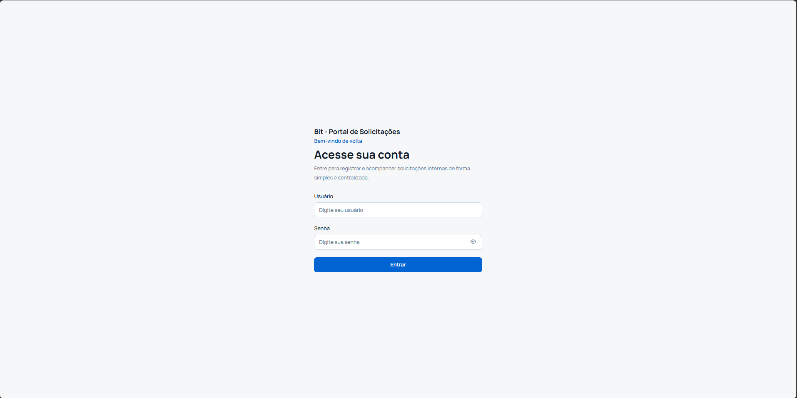
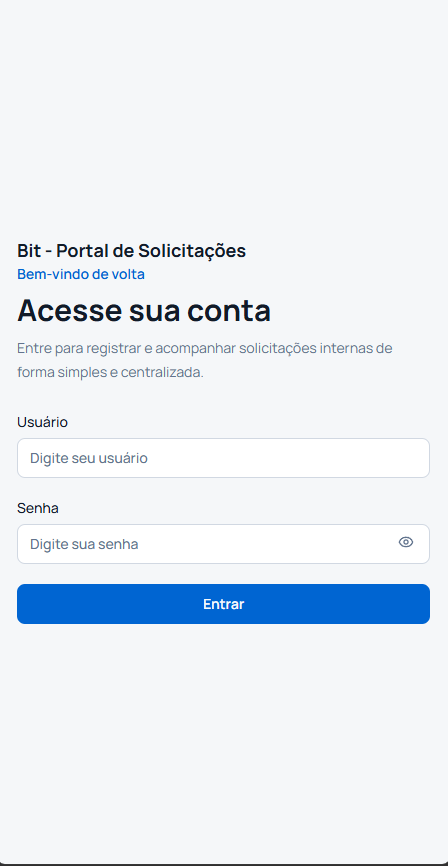
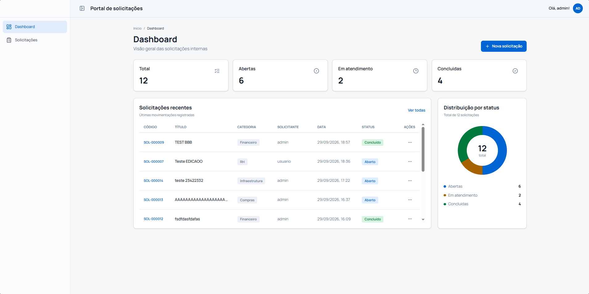
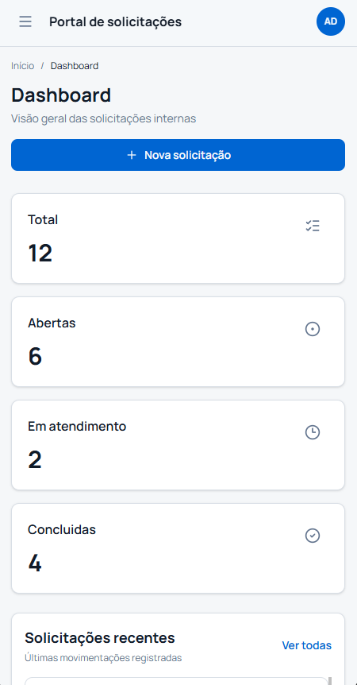
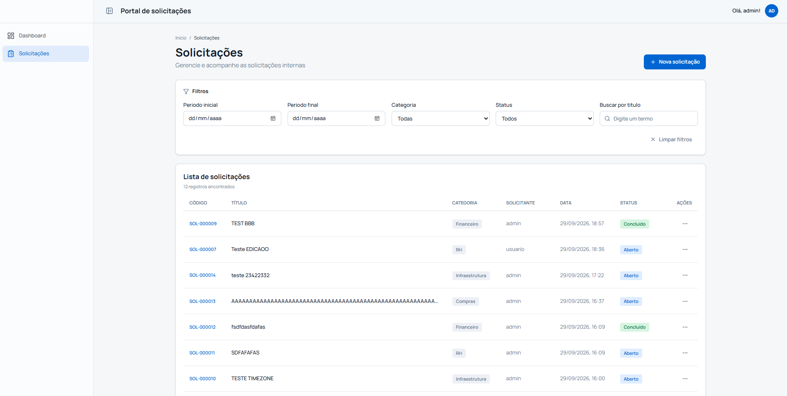
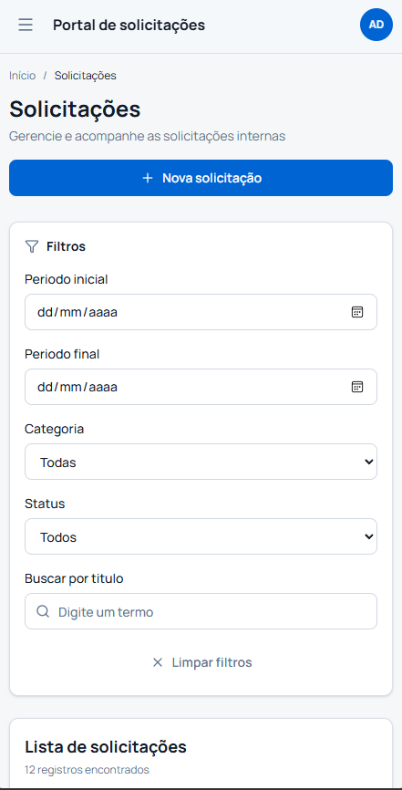
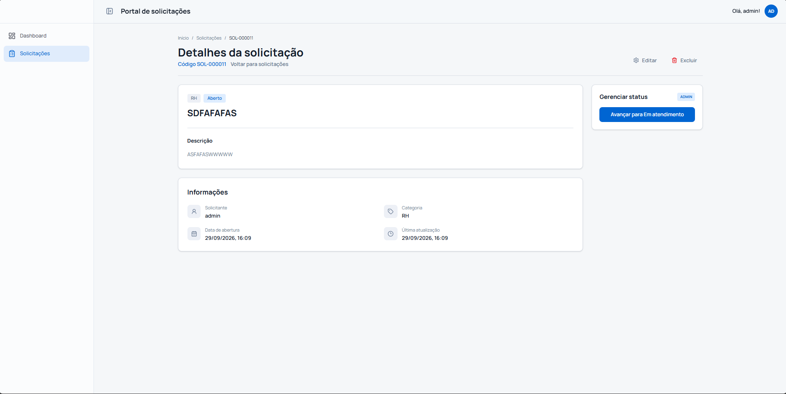
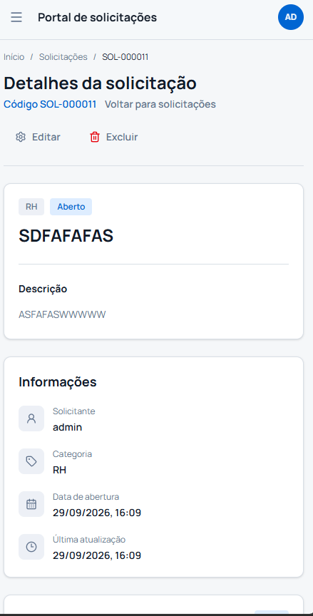
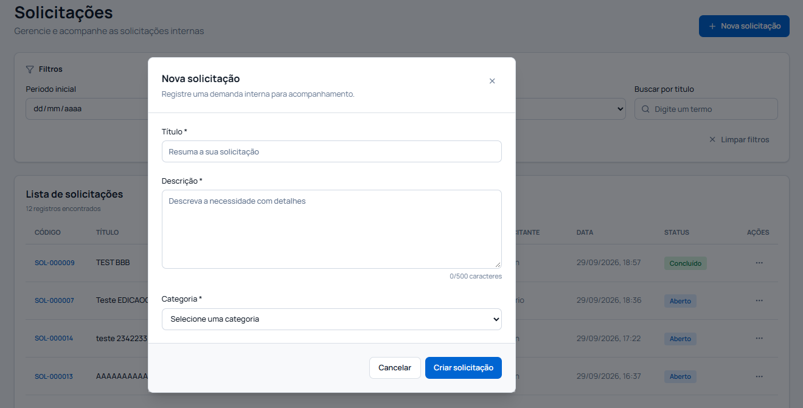
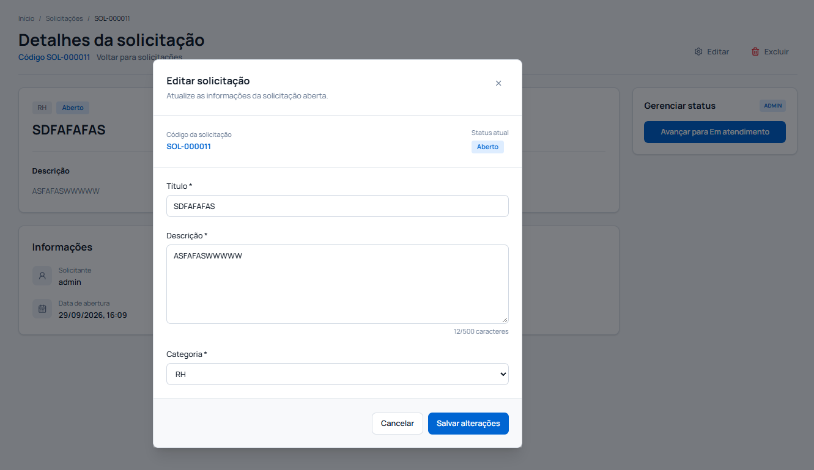

# Portal de Solicitações Internas

Sistema full stack para registro, acompanhamento e gerenciamento de solicitações internas, desenvolvido para a segunda etapa do processo seletivo da bit Soluções.

O projeto permite que usuários criem solicitações, acompanhem detalhes e editem ou excluam solicitações abertas próprias. Administradores visualizam todas as solicitações ativas e alteram o status conforme o fluxo permitido.

## Tecnologias

Backend:

- Java 21
- Spring Boot
- Spring Web
- Spring Security
- JWT
- Spring Data JPA
- Hibernate
- PostgreSQL
- Flyway
- Bean Validation
- Lombok
- SpringDoc OpenAPI
- JUnit 5
- Mockito

Frontend:

- React
- TypeScript
- Vite
- Tailwind CSS
- React Hook Form
- Zod
- TanStack Query
- TanStack Router

Infraestrutura:

- Docker
- Docker Compose
- GitHub Actions

## Documentação complementar

- [Memorial técnico de desenvolvimento](docs/MEMORIAL_TECNICO_DE_DESENVOLVIMENTO.md)
- [Dicionário de dados](docs/DICIONARIO_DE_DADOS.md)
- [Workflow de CI/CD](.github/workflows/ci-cd.yml)

## Evidências visuais

As capturas abaixo demonstram os principais fluxos e a responsividade da interface.

### Login




### Dashboard




### Solicitações




### Detalhes e modais






## Estrutura do projeto

```text
.
|-- backend/
|   |-- src/main/java/com/bit/solicitacoes/
|   |   |-- controller/
|   |   |-- service/
|   |   |-- repository/
|   |   |-- entity/
|   |   |-- dto/
|   |   |-- enums/
|   |   |-- security/
|   |   |-- exception/
|   |   `-- config/
|   |-- src/main/resources/db/migration/
|   |-- .env.example
|   |-- Dockerfile
|   `-- pom.xml
|-- frontend/
|   |-- src/
|   |   |-- components/
|   |   |-- contexts/
|   |   |-- layouts/
|   |   |-- pages/
|   |   |-- schemas/
|   |   |-- services/
|   |   |-- types/
|   |   |-- utils/
|   |   |-- main.tsx
|   |   `-- router.tsx
|   |-- tests/
|   |-- .env.example
|   |-- Dockerfile
|   |-- index.html
|   `-- package.json
|-- docs/
|   |-- DICIONARIO_DE_DADOS.md
|   `-- MEMORIAL_TECNICO_DE_DESENVOLVIMENTO.md
|-- evidencias/
|-- .github/workflows/ci-cd.yml
`-- docker-compose.yml
```

## Pré-requisitos

Para execução local sem Docker:

- Java 21
- Maven 3.9+
- Node.js 22+
- npm
- PostgreSQL 16+

Para execução com Docker:

- Docker
- Docker Compose

## Variáveis de ambiente

Os exemplos ficam separados por contexto:

- Backend: `backend/.env.example`
- Frontend: `frontend/.env.example`

Backend:

```env
DATABASE_URL=jdbc:postgresql://localhost:5432/solicitacoes
DATABASE_USERNAME=postgres
DATABASE_PASSWORD=postgres
JWT_SECRET=change-me-with-at-least-32-characters
JWT_EXPIRATION_SECONDS=3600
CORS_ALLOWED_ORIGINS=http://localhost:5173
APP_TIME_ZONE=America/Sao_Paulo
TZ=America/Sao_Paulo
```

Frontend:

```env
VITE_API_URL=http://localhost:8080/api
```

## Banco de dados

O banco utilizado é PostgreSQL.

As alterações estruturais são versionadas por Flyway em:

```text
backend/src/main/resources/db/migration/
```

Migrations existentes:

- `V1__create_tables.sql`: cria tabelas `usuarios` e `solicitacoes`.
- `V2__create_indexes.sql`: cria índices de consulta.
- `V3__insert_demo_data.sql`: insere usuários e solicitações de demonstração.

O Hibernate está configurado com:

```yaml
spring.jpa.hibernate.ddl-auto: validate
```

Assim, o schema é validado contra as migrations em vez de ser criado automaticamente pela aplicação.

## Executando com Docker Compose

Na raiz do projeto:

```bash
docker compose up --build
```

Serviços:

- PostgreSQL: `localhost:5432`
- Backend: `http://localhost:8080`
- Frontend: `http://localhost:5173`
- Swagger: `http://localhost:8080/swagger-ui.html`

Para parar:

```bash
docker compose down
```

Para remover também o volume do banco:

```bash
docker compose down -v
```

## Executando o backend localmente

Suba um PostgreSQL local ou via Docker e configure as variáveis de ambiente equivalentes ao arquivo `backend/.env.example`.

Depois:

```bash
cd backend
mvn spring-boot:run
```

A API ficará disponível em:

```text
http://localhost:8080
```

## Executando o frontend localmente

```bash
cd frontend
npm install
npm run dev
```

O frontend ficará disponível em:

```text
http://localhost:5173
```

## Credenciais de demonstração

Administrador:

```text
username: admin
password: admin123
```

Usuário comum:

```text
username: usuario
password: usuario123
```

As senhas são armazenadas no banco com hash BCrypt.

## Endpoints principais

Autenticação:

- `POST /api/auth/login`
- `GET /api/auth/me`

Solicitações:

- `GET /api/solicitacoes`
- `GET /api/solicitacoes/{id}`
- `POST /api/solicitacoes`
- `PUT /api/solicitacoes/{id}`
- `DELETE /api/solicitacoes/{id}`
- `PATCH /api/solicitacoes/{id}/status`

Dashboard:

- `GET /api/dashboard`

Swagger:

- `GET /swagger-ui.html`

## Regras principais

- `USER` cria solicitações, visualiza suas próprias solicitações, edita e exclui somente solicitações próprias em status `ABERTO`.
- `ADMIN` visualiza todas as solicitações ativas e altera status.
- Exclusão é feita por soft delete com preenchimento de `deleted_at`.
- Solicitações excluídas não aparecem nas listagens nem no dashboard.
- Fluxo de status permitido: `ABERTO` -> `EM_ATENDIMENTO` -> `CONCLUIDO`.
- Não há retrocesso de status.

## Filtros de solicitações

O endpoint `GET /api/solicitacoes` aceita:

- `page`
- `size`
- `status`
- `categoria`
- `dataInicio`
- `dataFim`
- `titulo`

Exemplo:

```text
GET /api/solicitacoes?page=0&size=10&status=ABERTO&categoria=TI
```

## Testes

Backend:

```bash
cd backend
mvn test
```

Frontend:

```bash
cd frontend
npm run test:run
npm run lint
npm run build
```

O backend possui testes automatizados para regras de serviço, dashboard, controller e hash das credenciais de demonstração.

O frontend possui testes automatizados com Vitest, Testing Library e jsdom para validações de formulário, utilitários de status/categoria, camada de API e componentes reutilizáveis.

## CI/CD

O projeto possui workflow em:

```text
.github/workflows/ci-cd.yml
```

O pipeline executa:

- Testes do backend com Java 21 e Maven.
- Testes, lint e build do frontend com Node.js 22.
- Validação e build dos serviços com Docker Compose.

Como o projeto é executado localmente e não exige deploy público, a etapa de entrega contínua valida o empacotamento Docker em vez de publicar em ambiente externo.
